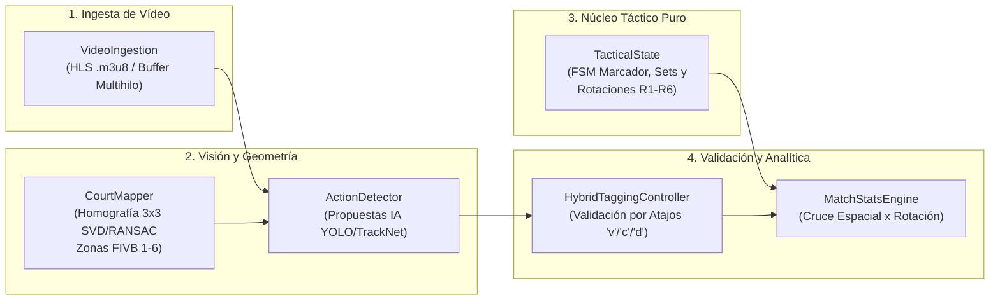

<div align="center">

# 🏐 data_voley

**Motor de Analítica Espacial (Homografía 3D→2D) y Máquina de Estados Táctica FIVB (Rotaciones R1–R6) para Streaming de Voleibol**

[](https://www.python.org/)
[](https://github.com/Kekkan74/data_voley)
[](https://github.com/Kekkan74/data_voley)
[](https://www.fivb.com/)

</div>

---

## ⚡ 1. Evidencia Visual y Salida Verificada (`python main.py --demo`)

```text
╔════════════════════════════════════════════════════════════════════╗
║ 🏐 DATA_VOLEY // SPATIAL & TACTICAL ANALYTICS ENGINE               ║
║ Homography 3D->2D • Rotations R1-R6 FSM • Hybrid AI/Hotkey Tagging ║
╚════════════════════════════════════════════════════════════════════╝
     1. MAPEO ESPACIAL POR HOMOGRAFÍA (PÍXELES 3D -> PLANO 2D FIVB 18x9m)
  Acción / Punto Cámara            Pixel (u, v)   Pista 2D (x, y) [m]   Campo           Zona FIVB
 ─────────────────────────────────────────────────────────────────────────────────────────────────
  Saque Zaguero Derecho (HOME)     (1480, 880)    (7.70m, 1.01m)        HOME            Zona 1
  Remate Punta Z4 (HOME)           (520, 550)     (1.14m, 7.17m)        HOME            Zona 4
  Remate Opuesto Z2 (HOME)         (1380, 550)    (7.71m, 7.17m)        HOME            Zona 2
  Defensa Z6 Centro (AWAY)         (960, 310)     (4.50m, 13.88m)       AWAY            Zona 6
  Balón Fuera Fondo (OUT)          (960, 140)     (4.50m, 20.64m)       OUT_OF_BOUNDS   FUERA (OUT)

     2. ESTADO TÁCTICO ACTUAL (HOME: R6 | Colocador en Zona 2)
  Zona FIVB   Fila                 Rol Táctico Inferido (Sin OCR)
 ─────────────────────────────────────────────────────────────────
  Zona 1      Zaguero (Defensa)    MIDDLE_2
  Zona 2      Delantero (Ataque)   SETTER
  Zona 3      Delantero (Ataque)   OUTSIDE_1
  Zona 4      Delantero (Ataque)   MIDDLE_1
  Zona 5      Zaguero (Defensa)    OPPOSITE
  Zona 6      Zaguero (Defensa)    OUTSIDE_2
```

---

## 🏗️ 2. Arquitectura del Sistema (Alta Cohesión y Bajo Acoplamiento)



---

## 📐 3. Fundamentos Matemáticos y Tácticos

### A. Transición de Rotaciones (R1–R6) al Recuperar el Saque (*Side-Out*)
Sea $R_T(t) \in \{1, 2, 3, 4, 5, 6\} \cong \mathbb{Z}_6$ la rotación activa del equipo $T \in \{\text{HOME}, \text{AWAY}\}$ en el rally $t$, y sea $S(t)$ el equipo en posesión del saque. Cuando el rally finaliza con victoria del equipo $W(t)$:

1. **Retención de saque (*Break Point*, $W(t) = S(t)$):** El equipo sacador anota punto y conserva el saque; **ningún equipo rota**:
   $$R_{\text{HOME}}(t+1) = R_{\text{HOME}}(t), \quad R_{\text{AWAY}}(t+1) = R_{\text{AWAY}}(t)$$
2. **Recuperación de saque (*Side-Out*, $W(t) \neq S(t)$):** El equipo receptor gana el rally, adquiere la posesión del saque ($S(t+1) = W(t)$) y **únicamente el equipo receptor avanza una posición en sentido horario**:
   $$R_{W(t)}(t+1) = \left( R_{W(t)}(t) \bmod 6 \right) + 1$$

### B. Inferencia de Roles sin OCR ni Reconocimiento Facial
Dado que las zonas FIVB ($Z_1 \dots Z_6$) se numeran en sentido **antihorario** mientras los jugadores rotan en sentido **horario** ($Z_2 \to Z_1 \to Z_6 \to Z_5 \to Z_4 \to Z_3 \to Z_2$), cualquier rol situado en la zona base $z_0 \in \{1 \dots 6\}$ en $R_1$ ocupa en la rotación $R_k$ ($k \in \{1 \dots 6\}$) la zona:
$$z(R_k) = \left( (z_0 - k) \bmod 6 \right) + 1$$

### C. Proyección Homográfica ($H \in \mathbb{R}^{3 \times 3}$)
`CourtMapper` resuelve la transformación proyectiva entre píxeles de cámara $(u, v)$ y el plano métrico oficial de la FIVB ($9.0\text{m} \times 18.0\text{m}$) mediante *Direct Linear Transform* (SVD) / RANSAC:
$$\begin{bmatrix} x' \\ y' \\ w' \end{bmatrix} = H \begin{bmatrix} u \\ v \\ 1 \end{bmatrix}, \quad (x, y) = \left( \frac{x'}{w'}, \frac{y'}{w'} \right)$$
Respetando la simetría de $180^\circ$ entre la pista local (`HOME`: $0 \le y \le 9\text{m}$) y la pista visitante (`AWAY`: $9 < y \le 18\text{m}$).

---

## 🚀 4. Quickstart en 1 Clic (`DataVoley.exe` / App Gráfica Visual)

```bash
# Opción A: Doble clic directo en el ejecutable nativo de Windows:
./DataVoley.exe

# Opción B: Lanzar la aplicación gráfica interactiva desde Python:
python run_app.py

# Opción C: Ejecutar simulación táctica en consola (CLI) y los 26 tests TDD:
python main.py --demo
pytest tests/ -v
```

### 📊 Paneles Gráficos Interactivos Incluidos en `DataVoley.exe`:
1. **Pista 2D FIVB Teraflex Interactiva (`18m × 9m`):** Muestra las 6 zonas de ambos campos, la línea de 3 metros, los vectores de trayectoria de remates y las fichas dinámicas de los 6 jugadores (`SETTER` en oro Mikasa, `LIBERO`, `OPP`, `OH1`, `OH2`, `MB1`) moviéndose automáticamente con cada *Side-Out*. **Hacer clic en cualquier punto de la pista proyecta la homografía $H$ y registra la acción en vivo.**
2. **Selector y Rueda de Rotaciones (`R1` – `R6`):** Permite inspeccionar o cambiar de rotación viendo al instante dónde se ubica el colocador (`Z1 → Z6 → Z5 → Z4 → Z3 → Z2`) sin necesidad de OCR.
3. **Gráfico de Barras Apiladas — Eficiencia de Remates por Zona (`Z1` a `Z6`):** Desglose visual de *Kills* (verde esmeralda), *En Juego* (cian) y *Errores/Bloqueos* (rojo) junto al porcentaje de eficiencia ofensiva de cada zona.
4. **Gráfico de Vulnerabilidad — Saques Fallados por Rotación (`R1` a `R6`):** Cruza los errores de saque (`Red` vs `Fuera`) y *Aces* con la rotación activa, señalando automáticamente la formación más crítica del equipo.
5. **Consola de Etiquetado Híbrido (IA + Atajos de Teclado):** Valida (`[V]`), corrige (`[C]`) o descarta (`[D]`) las propuestas de YOLO/TrackNet o suma puntos (`[H]` / `[A]`) actualizando todos los gráficos en tiempo real.

---

## ⚖️ 5. Decisiones de Ingeniería (Mini-ADR)

| Decisión | Enfoque Elegido | Alternativa Descartada | Justificación Técnica |
| :--- | :--- | :--- | :--- |
| **Inferencia de Roles** | Máquina de Estados FIVB ($\mathbb{Z}_6$) en `TacticalState` | OCR de dorsales en cada frame | En streams HLS con compresión y oclusión en la red, la inferencia determinista por rotación ofrece un 100% de precisión con coste computacional $O(1)$. |
| **Solver de Homografía** | DLT vía `numpy.linalg.svd` + RANSAC opcional con OpenCV | Dependencia dura exclusiva de `cv2` | Permite ejecutar tests geométricos y pipelines CI ligeros sin binarios gráficos pesados, manteniendo soporte completo para flujos de vídeo. |
| **Etiquetado de Datos** | Controlador Híbrido IA + Atajos (`v`/`c`/`d`) | Etiquetado 100% automático sin supervisión | Garantiza un *ground-truth* libre de falsos positivos para análisis táctico de alto rendimiento. |

---

## 📂 6. Estructura del Proyecto

```text
data_voley/
├── src/data_voley/
│   ├── domain/            # Entidades inmutables, Enums FIVB y Puertos (Protocols)
│   ├── tactical_state/    # TacticalState: FSM de marcador, sets y rotaciones R1-R6
│   ├── court_mapper/      # CourtMapper: Homografía 3x3 y clasificador de Zonas 1-6
│   ├── video_ingestion/   # VideoIngestion: Lector multihilo de streams HLS (.m3u8)
│   ├── action_detector/   # ActionDetector y HybridTaggingController (IA + Hotkeys)
│   └── stats_engine/      # MatchStatsEngine: Cruce de remates y saques por rotación
├── tests/                 # 23 tests unitarios y parametrizados con Pytest
├── main.py                # CLI interactivo y modo demostración (--demo)
├── pyproject.toml
└── requirements.txt
```
